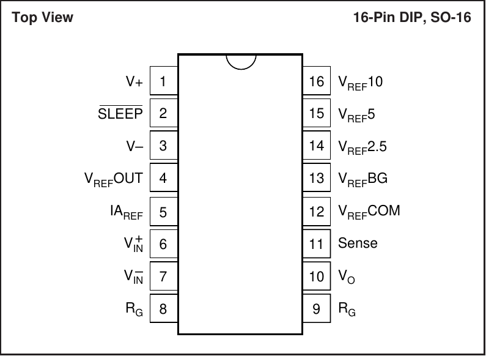

# INA125P: pinagem

Fonte: datasheet da Texas Instruments (antiga Burr-Brown), "INA125: Instrumentation Amplifier with Precision Voltage Reference", página 4, *Pin Configuration*. PDF: <https://www.ti.com/lit/ds/symlink/ina125.pdf>. O INA125P é a versão em DIP de 16 pinos, a mesma do relatório.

**Vista de cima** (com as letras do CI para cima). O pino 1 fica do lado do chanfro (meia-lua) e muitas vezes tem também um ponto marcado no corpo. A contagem segue para baixo do lado esquerdo (1 a 8) e volta subindo pelo lado direito (9 a 16).

## Ligação no projeto

Conferida contra o esquemático [`esq_pt100_ina125.png`](../../relatorio/figuras/esq_pt100_ina125.png): **todos os pinos batem com o datasheet.**

| Pino | Nome | Função | Ligação no projeto |
|---|---|---|---|
| 1 | V+ | alimentação positiva | **5 V** do Arduino |
| 2 | SLEEP (barra em cima) | ativo em nível baixo: em 0 V ou solto o INA desliga | **5 V** (ligado ao pino 1) |
| 3 | V− | alimentação negativa | **GND** |
| 4 | VREFOUT | saída da referência interna | sem ligação |
| 5 | IAREF | referência da saída do amplificador | **GND** |
| 6 | VIN+ | entrada não inversora | **nó a** (entre R3 e Pt100 A) |
| 7 | VIN− | entrada inversora | **nó b** (entre Pt100 B e R5) |
| 8 | RG | resistor de ganho | **RG 330 Ω** entre 8 e 9 |
| 9 | RG | resistor de ganho | **RG 330 Ω** entre 8 e 9 |
| 10 | VO | saída | **1 kΩ do filtro** → A0, e ligado ao pino 11 |
| 11 | Sense | realimentação da saída | **ligado ao pino 10** |
| 12 | VREFCOM | comum da referência interna | **GND** |
| 13 | VREFBG | referência 1,24 V | sem ligação |
| 14 | VREF2.5 | referência 2,5 V | sem ligação |
| 15 | VREF5 | referência 5 V | sem ligação |
| 16 | VREF10 | referência 10 V | sem ligação |

Mais o capacitor de **100 nF entre os pinos 1 e 3**, perto do CI.

## Pontos de atenção na montagem

* O pino 2 tem uma barra em cima do nome (SLEEP com barra = ativo em nível baixo). Se ficar solto ou em 0 V, o CI fica em modo sleep e a saída vai a 0 V.
* Os pinos 10 e 11 ficam lado a lado no lado direito. Basta um jumper curto entre eles.
* Os pinos 8 e 9 ficam um em frente ao outro, na base do CI, um de cada lado do vão central da protoboard. O RG atravessa o vão.
* Com o CI encaixado no vão central da protoboard, cada pino fica numa coluna separada. Conferir que nenhum fio de um pino caiu na coluna do pino vizinho.
