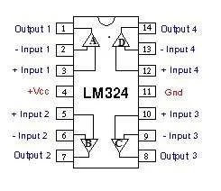
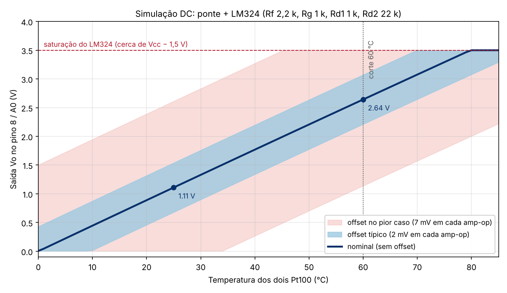

# LM324: amplificador de instrumentação no lugar do INA125P

O INA125P queimou (ver [ensaio 01](../ensaios/01-sensores-2026-11-26.md)) e não havia outro no laboratório. No lugar dele entrou um **LM324** (4 amplificadores operacionais no mesmo CI), montado como **amplificador de instrumentação de 3 amp-ops**. A ponte, a ligação a 3 fios, o filtro RC (1 kΩ + 100 µF) e o A0 não mudam.

* Circuito completo (ponte + LM324 como um componente + filtro): [`esq_completo_lm324.png`](esq_completo_lm324.png)
* Esquema só do amplificador, com os 3 amp-ops separados: [`esq_pt100_lm324.png`](esq_pt100_lm324.png)
* Montagem pino a pino: [`lm324-montagem.png`](lm324-montagem.png)

## Pinagem (DIP-14, vista de cima)

O pino 1 fica do lado do chanfro (meia-lua). A contagem desce pelo lado esquerdo (1 a 7) e volta subindo pelo lado direito (8 a 14).

## Circuito

Resistores escolhidos com o que havia no laboratório (não havia 10 kΩ): **Rf = 2,2 kΩ, Rg = 1 kΩ, Rd1 = 1 kΩ, Rd2 = 22 kΩ**. Os nomes Rd1 e Rd2 (subtrator) evitam confusão com R3 e R5 da ponte.

* **U1A e U1B (estágio de entrada):** seguidores com ganho. O + de cada um recebe um nó da ponte, então não puxam corrente da ponte (mesmo papel das entradas do INA). Ganho diferencial G1 = 1 + 2 · Rf / Rg = 1 + 2 · 2,2 k / 1 k = 5,4.
* **U1C (subtrator):** ganho G2 = Rd2 / Rd1 = 22 k / 1 k = 22, referência no GND.
* **Ganho total:** G = G1 · G2 ≈ **119** (antes 186 com o INA).
* Vo = 119 · (Va − Vb). Saída positiva e crescente com a temperatura, como antes.

| Pino | Nome | Ligação no projeto |
|---|---|---|
| 1 | Out 1 | Rf 2,2 kΩ até o pino 2; Rd1 1 kΩ até o pino 9 |
| 2 | −In 1 | Rf 2,2 kΩ até o pino 1; Rg 1 kΩ até o pino 6 |
| 3 | +In 1 | **nó b** (fio do par do Pt100 B) |
| 4 | +Vcc | **5 V** do Arduino; 100 nF até o pino 11 |
| 5 | +In 2 | **nó a** (fio do par do Pt100 A) |
| 6 | −In 2 | Rf 2,2 kΩ até o pino 7; Rg 1 kΩ até o pino 2 |
| 7 | Out 2 | Rf 2,2 kΩ até o pino 6; Rd1 1 kΩ até o pino 10 |
| 8 | Out 3 | Rd2 22 kΩ até o pino 9; **1 kΩ do filtro** → A0 |
| 9 | −In 3 | Rd1 1 kΩ vindo do pino 1; Rd2 22 kΩ até o pino 8 |
| 10 | +In 3 | Rd1 1 kΩ vindo do pino 7; Rd2 22 kΩ até o GND |
| 11 | Gnd | **GND** do Arduino |
| 12 | +In 4 | GND (U1D sem uso) |
| 13 | −In 4 | ligado ao pino 14 (U1D sem uso) |
| 14 | Out 4 | ligado ao pino 13 (U1D sem uso) |

Lista: 2 × 2,2 kΩ (Rf), 1 × 1 kΩ (Rg), 2 × 1 kΩ (Rd1), 2 × 22 kΩ (Rd2), 1 × 100 nF, 1 × LM324.

## Por que funciona com 5 V e o que muda

* A entrada do LM324 aceita de 0 a cerca de 3,5 V (Vcc − 1,5 V). Os nós da ponte ficam perto de 2 V e as saídas de U1A e U1B variam no máximo cerca de 0,07 V em torno disso.
* A saída só sobe até cerca de **3,5 V** (o INA chegava a 4,2 V). Por isso o ganho foi reduzido de 186 para 119.
* Sensibilidade: **44,4 mV/°C**, resolução de 0,11 °C por contagem do A/D (antes 0,07 °C).
* Faixa: saída de cerca de 0,15 a 3,4 V, que dá **cerca de 3 a 76 °C**. Cobre o corte de 60 °C (2,67 V) com folga.
* O offset de entrada do LM324 (típico 2 mV, máximo 7 mV por amp-op) aparece na saída. Os offsets de U1A e U1B se somam na diferença e são multiplicados por 119; o de U1C, por 23. Com valores típicos, a saída fica deslocada em até cerca de ±0,4 V; no pior caso, até cerca de ±1,5 V, o que já tiraria a faixa útil (ver [Simulação](#simulação)). É um erro fixo, absorvido pela calibração em 2 pontos, **desde que a saída não fique presa em 0 V ou em 3,5 V**.
* O casamento dos resistores do subtrator (Rd1 com Rd1, Rd2 com Rd2) define a rejeição de modo comum. Com 1 %, o erro fica em algumas dezenas de mV na saída, também fixo. Se tiver multímetro, escolher os pares mais parecidos.

### Outras combinações possíveis

G = (1 + 2 · Rf / Rg) · (Rd2 / Rd1). Alvo: G entre 100 e 130 (acima de cerca de 150 a saída satura antes de 60 °C). Resistores de pelo menos 680 Ω.

| | Rf (×2) | Rg | Rd1 (×2) | Rd2 (×2) | Ganho | mV/°C | Até |
|---|---|---|---|---|---|---|---|
| **A (usada)** | **2,2 kΩ** | **1 kΩ** | **1 kΩ** | **22 kΩ** | **119** | **44,4** | **76 °C** |
| B | 1,5 kΩ | 680 Ω | 1 kΩ | 22 kΩ | 119 | 44,5 | 76 °C |
| C | 4,7 kΩ | 2,2 kΩ | 1 kΩ | 22 kΩ | 116 | 43,4 | 78 °C |
| D | 22 kΩ | 3,9 kΩ | 3,3 kΩ | 33 kΩ | 123 | 45,9 | 74 °C |
| E | 10 kΩ | 1,8 kΩ | 10 kΩ | 100 kΩ | 121 | 45,3 | 75 °C |

Se trocar a combinação, atualizar `SENS_V_POR_C` (0,000374 × G), `V_REF_25C` e `GANHO_AMP` nos firmwares.

## Valores esperados (alimentação de 5,00 V)

| Ponto | 20 °C | 25 °C | 30 °C |
|---|---|---|---|
| Vab | 7,48 mV | 9,34 mV | 11,20 mV |
| Pino 7 − pino 1 (G1 · Vab) | 40,4 mV | 50,4 mV | 60,5 mV |
| Pino 8 (Vo) e A0 | 0,889 V | 1,110 V | 1,331 V |
| `A0_cont` | 182 | 227 | 272 |

Somar o offset do CI (algumas centenas de mV são normais). O que importa é a **variação**: segurando um Pt100 com os dedos, Vo sobe cerca de 22 mV por °C de aquecimento desse sensor (44 mV/°C quando os dois aquecem juntos).

## Pontos de atenção na montagem

* CI encaixado no vão central da protoboard; cada pino em uma coluna separada.
* Rg (pino 2 ao 6) e os Rd1 que vão do pino 1 ao 9 e do 7 ao 10 atravessam o CI: usar fios ou pernas compridas, sem encostar em outros pinos.
* Cuidado para não trocar Rd1 (1 kΩ) e Rd2 (22 kΩ): com eles invertidos o ganho do subtrator cai para 0,05 e a saída fica perto de 0 V.
* Não deixar o U1D com entradas soltas (pode oscilar e gerar ruído nos outros três).
* Retirar o INA125P da protoboard e conferir que não ficou nenhum jumper antigo nas colunas.

## Simulação

Simulação DC no ngspice da ponte com o amplificador, varrendo a temperatura dos dois Pt100 de 0 a 85 °C (curva de Callendar-Van Dusen). O LM324 foi representado por um modelo comportamental: ganho de 100 dB, saída de 0 a Vcc − 1,5 V e offset de entrada ajustável. Netlist: [`lm324_ponte.cir`](lm324_ponte.cir) (rodar com `ngspice -b lm324_ponte.cir`).

| Caso | Vo a 25 °C | Vo a 60 °C | Faixa útil |
|---|---|---|---|
| Nominal (sem offset) | 1,110 V | 2,642 V | 2 a 79 °C |
| Offset típico (2 mV em cada amp-op, somando no pior sentido) | 0,68 a 1,54 V | 2,21 a 3,07 V | começa em até 11 °C / satura a partir de 69 °C |
| Offset máximo (7 mV em cada amp-op) | 0,01 a 2,61 V | 1,14 a 3,50 V | presa em 0 V até 36 °C / satura a partir de 45 °C |
| Rd1 e Rd2 com 1 % no pior sentido | 1,148 V | 2,682 V | 1 a 78 °C |

* Os nós da ponte e as saídas de U1A e U1B batem com a tabela de valores esperados (a 25 °C: pino 7 = 2,045 V, pino 1 = 1,995 V, pino 8 = 1,110 V).
* Usando a reta teórica do firmware (`SENS_V_POR_C` = 0,0444, `V_REF_25C` = 1,110), o erro fica entre −0,49 e +0,03 °C de 15 a 60 °C, por causa da não linearidade do Pt100. Com calibração em 2 pontos (20 e 50 °C), o erro cai para no máximo 0,09 °C nessa faixa.

**Conferência na bancada:** com tudo à temperatura ambiente (cerca de 25 °C), Vo deve ficar **entre cerca de 0,5 e 1,7 V**. Fora disso, o offset do CI está grande demais. Opções, da mais simples para a mais trabalhosa:
1. Trocar o U1A ou o U1B pelo U1D, que está sobrando (pinos 12, 13 e 14), e ver se melhora.
2. Testar outro LM324.
3. Reduzir o ganho com um Rg maior (por exemplo, 1,5 kΩ: G ≈ 87).
